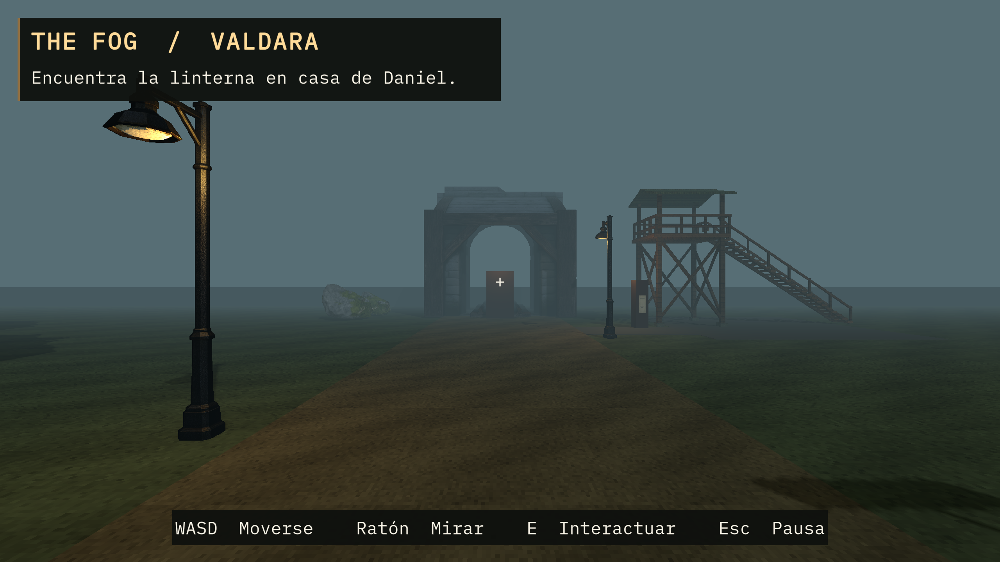
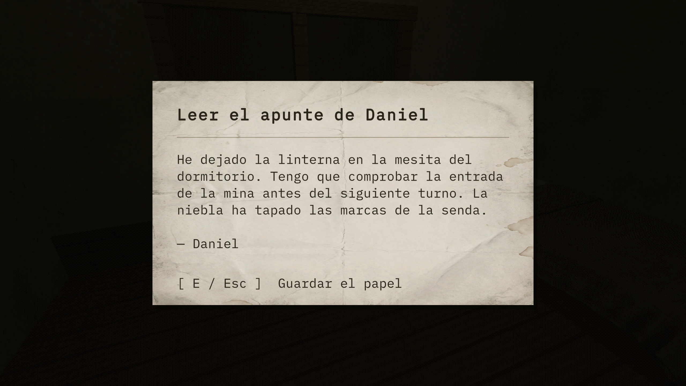
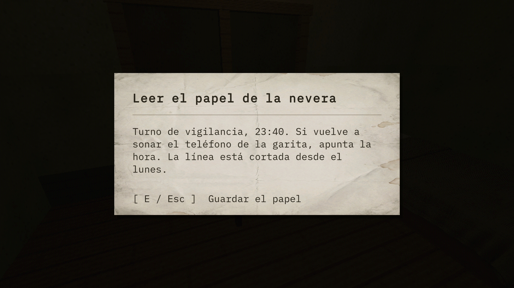
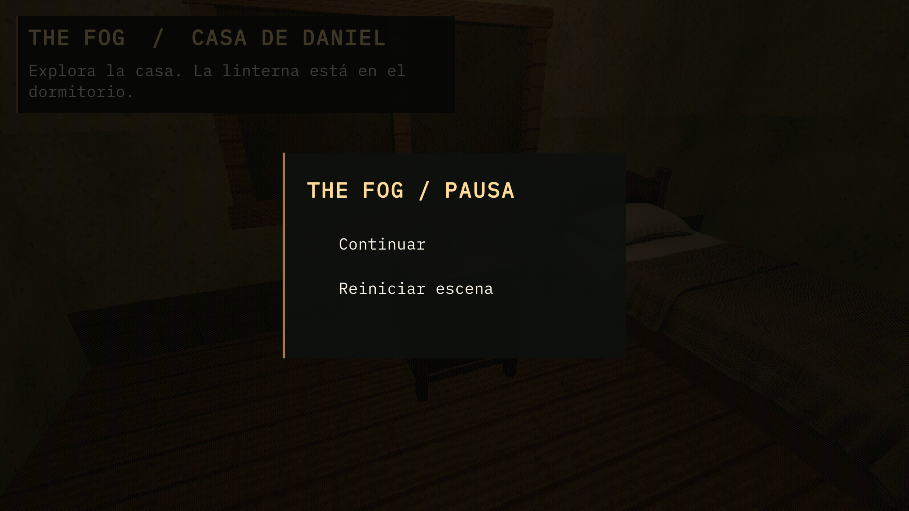

# 🌫️ Avance de THE FOG · Casa de Daniel y Valdara

Revisión del 12 de noviembre de 2026 sobre `de2e551` en `unity/casa-daniel`, con Unity 6000.6.8f1. La escena de la casa incluye documentos interactivos, muebles con estados abierto y cerrado y un menú de pausa. En Valdara ya se ve el camino hacia la mina con farolas, niebla y la torre provisional.

## 📸 Capturas del prototipo en ejecución

### Camino hacia la mina

### Documentos interactivos

### Menú de pausa

## 🧪 Resultado de la revisión

- Se abrieron las dos notas y se detectaron sus objetos físicos.
- La alacena y el fregadero volvieron al estado cerrado tras abrirlos.
- Unity detectó suelo en dos de los cuatro puntos de control en Valdara. La prueba dio **FAIL** al no detectar suelo en `z=-30` y `z=46`. Falta confirmar a pie si se trata de colisiones o del momento en el que se ejecuta la comprobación tras cargar la escena.

[Resultado completo de Unity](resultados.txt)

## 🎯 Siguiente trabajo

- Probar a pie casa → Valdara → tienda → mina y regreso. Verificar los dos puntos de suelo y el acceso a la torre.
- Revisar tipografía y contraste en la resolución objetivo.
- Contrastar puerta, lámpara de techo, ventana, radio y tablón con los archivos y escenas existentes antes de asignar nuevos modelos.

La revisión se hizo en modo Play del editor. Quedan pendientes el recorrido completo y la validación de un ejecutable de Windows.
