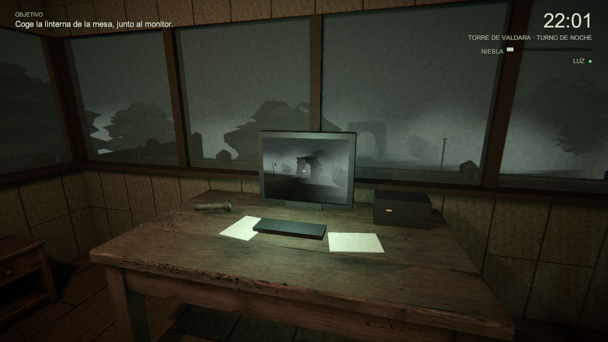
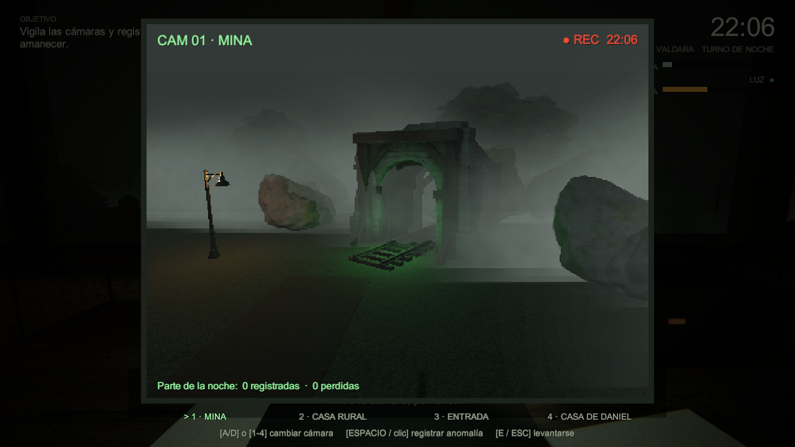
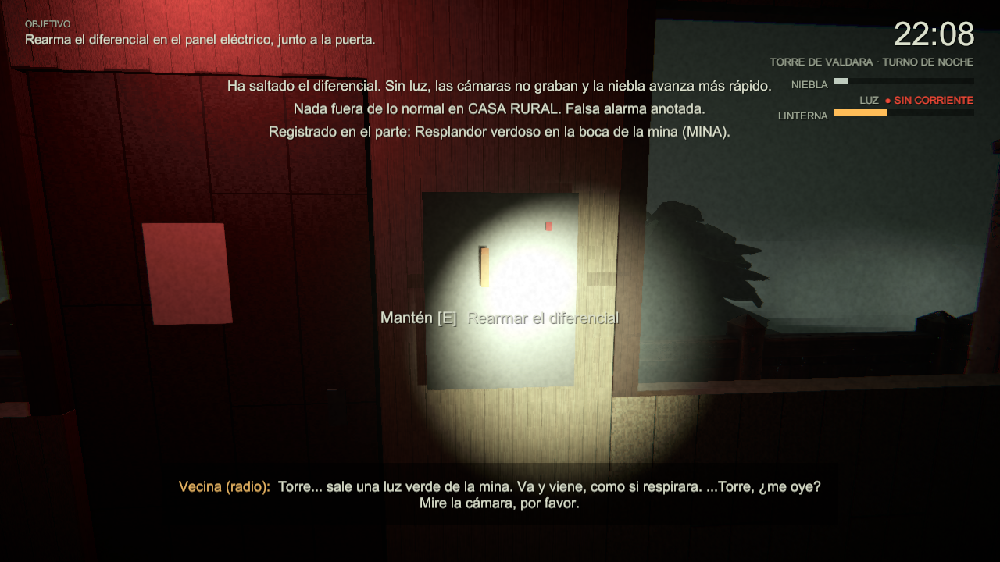
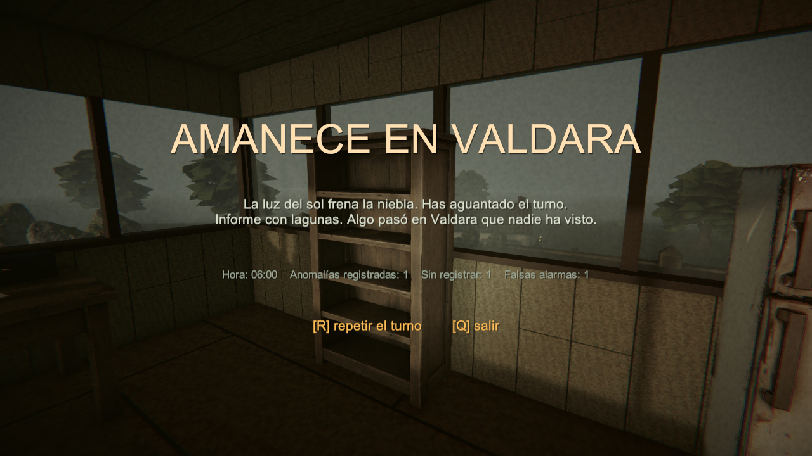

# 🌫️ Avance de Claude · Puesto de Daniel

Primera versión jugable del turno nocturno en la torre de Valdara. Daniel vigila cuatro cámaras, registra anomalías, rearma el cuadro eléctrico y administra las pilas de la linterna. El turno va de 22:00 a 06:00 y dura unos 11 minutos reales. Se gana al amanecer y se pierde si la niebla alcanza el 100 %.

## Capturas del ejecutable

## Pruebas

El [informe del ejecutable](informe.json) registra 24 comprobaciones aprobadas. Queda pendiente jugar un turno completo a mano para ajustar dificultad, ritmo y claridad de las indicaciones.

La escena del prototipo es `Assets/Scenes/PuestoDaniel.unity` en la copia local de Claude. Esta publicación contiene capturas y resultados.
